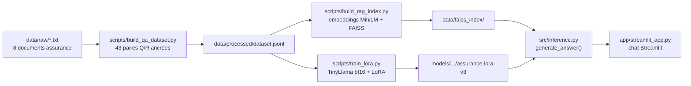

# 🛡️ Assurance LLM Assistant


-2C5C55)


Assistant IA spécialisé dans le domaine de l'**assurance et des sinistres**, combinant un **LLM fine-tuné avec LoRA (QLoRA)**, un système **RAG (FAISS)** auto-correcteur, et un **agent à outils** (function calling), exposés via une API FastAPI testée et une interface **Streamlit**.

Projet pédagogique conçu pour tourner de bout en bout sur une machine modeste (CPU, 8 Go de RAM) — un cas d'étude complet plutôt qu'un produit fini : chaque choix technique (taille du modèle, quantization, format du dataset, choix d'API vs modèle local) est documenté, mesuré et assumé.

---

## Sommaire

- [Architecture](#-architecture)
- [Le modèle](#-le-modèle--lora--qlora)
- [Le RAG](#-le-rag)
- [RAG correctif (LangGraph)](#-rag-correctif-langgraph)
- [Agent (function calling)](#-agent-function-calling)
- [Installation & démarrage](#-installation--démarrage)
- [Cas d'usage métier](#-cas-dusage-métier)
- [Stack technique](#️-stack-technique)
- [Structure du projet](#-structure-du-projet)
- [Limites connues & pistes d'amélioration](#-limites-connues--pistes-damélioration)

---

## 🏗️ Architecture



Deux chemins partent du même dataset : l'un **indexe les faits** à retrouver au moment de la question (RAG), l'autre **apprend le style et le format de réponse** (LoRA). `inference.py` recombine les deux à chaque requête.

---

## 🧠 Le modèle — LoRA / QLoRA

| Paramètre | Valeur |
|---|---|
| Modèle de base | `TinyLlama/TinyLlama-1.1B-intermediate-step-1431k-3T` |
| Méthode | LoRA (PEFT) — base gelée, `bfloat16` |
| Rang (`r`) | 16 |
| `lora_alpha` | 32 |
| Modules ciblés | `q_proj`, `v_proj` |
| Paramètres entraînables | 2 252 800 / 1 102 301 184 (**0.2 %**) |
| Dataset | 43 paires question/contexte/réponse écrites à la main |

**Pourquoi TinyLlama-1.1B plutôt qu'un modèle plus grand ?** Un choix de contrainte matérielle assumé : sur une machine à 8 Go de RAM sans GPU, un modèle 7-8B (Mistral, Llama-3) rend l'entraînement et même l'inférence peu fiables. TinyLlama tient confortablement, se fine-tune en ~1h30 sur CPU, et permet d'itérer plusieurs fois dans la même journée.

**Pourquoi bf16 direct plutôt que la quantization 4-bit à l'entraînement ?** `bitsandbytes` en 4-bit sur CPU s'est montré peu fiable en pratique (pic mémoire au chargement, calcul très lent lors du backward — voir *Limites* plus bas). Le chargement direct en `bfloat16` s'est révélé plus rapide et plus stable pour ce modèle, au prix d'un peu plus de RAM utilisée.

Le template de prompt (`format_conversation_prompt`, dans `src/utils.py`) est **strictement identique** à l'entraînement et à l'inférence — un point critique : un LLM fine-tuné associe une forme de prompt précise à une forme de réponse, un template différent casse cette association.

---

## 🔍 Le RAG

- **Embeddings** : `sentence-transformers/all-MiniLM-L6-v2` (384 dimensions)
- **Index** : FAISS `IndexFlatIP` + normalisation L2 (= similarité cosinus), recherche exacte — adapté à un corpus de cette taille (35 contextes uniques), pas pensé pour scaler à des millions de documents
- **Corpus** : les contextes factuels des 43 exemples du dataset (mêmes phrases sources que celles utilisées à l'entraînement, pour rester cohérent)

**Évaluation réelle du retrieval (`scripts/eval_retrieval.py`)** — self-retrieval sur les 38 paires question/contexte en domaine (self-retrieval : pour chaque question, on vérifie si son propre passage source ressort dans le top-k FAISS) :

| k | Recall@k |
|---|---|
| 1 | 39,5 % (15/38) |
| 3 | 65,8 % (25/38) |
| 5 | 76,3 % (29/38) |

Chiffre assumé, pas flatteur : pour 23 questions sur 38, le passage source n'est pas le 1er résultat renvoyé — souvent quand la question est formulée différemment du texte stocké. C'est directement ce qui a motivé le RAG correctif ci-dessous plutôt qu'une simple amélioration du retrieval seul.

---

## 🔁 RAG correctif (LangGraph)

Le RAG classique ci-dessus ne vérifie jamais rien : il récupère, colle dans le prompt, génère — pertinent ou non. `src/corrective_rag/graph.py` ajoute une boucle de contrôle avec **LangGraph** (graphe d'états à arêtes conditionnelles, motivé directement par le recall@1 mesuré à 39,5 %) :

```
retrieve → grade_documents → [pertinent ? generate : rewrite_query → retour à retrieve]
generate → verify_answer → [fondée ? fin : retour à generate]
```

Un compteur de tours partagé plafonne les deux boucles (jamais de boucle infinie sur une question hors corpus).

**Routage hybride des modèles, pas arbitraire** : les 3 nœuds de *jugement* (noter la pertinence, reformuler, vérifier la fidélité) appellent **Gemini** via API — même raison que pour l'agent ci-dessous, ce sont des tâches de raisonnement structuré que TinyLlama ne gère pas de façon fiable. Le nœud `generate`, lui, reste sur le **modèle local fine-tuné** — c'est exactement sa tâche d'entraînement, pas besoin d'un modèle plus gros pour ça.

Testé en conditions réelles (`scripts/test_corrective_rag.py`) : un run complet a produit une vraie hallucination locale (confusion entre "prime" et "franchise", deux termes adjacents dans le contexte récupéré) — et `verify_answer` l'a correctement détectée (`fondee=False`) plutôt que de la laisser passer. C'est le comportement recherché : un RAG classique aurait renvoyé cette réponse sans aucun filtre.

---

## 🤖 Agent (function calling)

`src/agent/loop.py` implémente une boucle ReAct **écrite à la main** (pas de LangChain/LangGraph ici, choix pédagogique délibéré pour maîtriser la séparation "le modèle propose, le code décide/exécute") au-dessus de l'API **Gemini** (palier gratuit) — pas du modèle local, qui n'est pas fiable pour choisir un outil et produire des arguments JSON valides.

**4 outils** : `search_docs` (réutilise le `RAGPipeline` existant), `calculer_franchise` et `verifier_delai_declaration` (logique métier déterministe, aucun appel LLM), `preparer_declaration_sinistre` (brouillon **simulé**, aucun effet de bord réel — un outil à effet de bord réel exigerait une confirmation explicite de l'utilisateur, pas seulement une décision du modèle).

**Garde-fous** : liste blanche d'outils (un nom halluciné n'est jamais exécuté), validation stricte des arguments (Pydantic — une erreur devient un message renvoyé au modèle, jamais un crash), plafond de tours, et un rappel explicite dans le prompt système que le résultat d'un outil est une donnée, jamais une instruction (défense contre l'injection de prompt indirecte via `search_docs`).

Exposé via `POST /agent/ask` (même pattern d'injection de dépendances que `/ask`) et un mode dédié dans l'interface Streamlit, avec affichage optionnel de la trace des outils utilisés.

---

## 🚀 Installation & démarrage

```bash
git clone https://github.com/falilou14/assurance-llm-assistant.git
cd assurance-llm-assistant

python -m venv .venv
.venv\Scripts\activate      # Windows -- source .venv/bin/activate sous Linux/Mac

pip install -r requirements.txt
```

> ⚠️ Les poids de l'adaptateur LoRA et les données ne sont **pas versionnés** (voir `.gitignore`) — il faut reconstruire le dataset, l'index RAG et ré-entraîner l'adaptateur avant de lancer l'app.

```bash
# 1. Construire le dataset question/réponse à partir de data/raw/
python scripts/build_qa_dataset.py

# 2. Construire l'index FAISS pour le RAG
python scripts/build_rag_index.py

# 3. Entraîner l'adaptateur LoRA (~1h30 sur CPU, TinyLlama-1.1B)
python scripts/train_lora.py

# 4. Lancer l'API (dans un terminal)
uvicorn api.main:app --port 8000

# 5. Lancer l'interface (dans un second terminal)
streamlit run app/streamlit_app.py
```

L'interface est disponible sur `http://localhost:8501`, l'API sur `http://localhost:8000` (doc interactive auto-générée sur `/docs`). Streamlit appelle l'API en HTTP -- il ne charge plus le modèle lui-même.

**Routes de l'API :**

| Route | Rôle |
|---|---|
| `GET /health` | Liveness -- le processus est-il vivant ? |
| `GET /ready` | Readiness -- le modèle local est-il chargé ? |
| `POST /ask` | RAG classique -&gt; réponse de TinyLlama+LoRA |
| `POST /agent/ask` | Agent -&gt; réponse de Gemini + trace des outils utilisés |

**Pour l'agent et le RAG correctif**, une clé Gemini (gratuite, [aistudio.google.com/apikey](https://aistudio.google.com/apikey)) est nécessaire :

```bash
cp .env.example .env
# puis éditer .env et renseigner GEMINI_API_KEY
```

`.env` est gitignored -- ne jamais le commit.

**Tester l'API seule** (sans Streamlit, ni même le modèle) :

```bash
pip install -r requirements-api.txt   # léger, sans torch -- utilisé aussi par la CI
APP_ENV=test pytest tests/test_api.py -v
```

### 🐳 Avec Docker (recommandé)

```bash
docker compose up
```

Construit et lance les deux services (`api` + `ui`), dans l'ordre : `ui` attend que `api` soit déclarée `healthy` avant de démarrer (`depends_on: condition: service_healthy`). Même adresses que ci-dessus une fois lancé.

- **Poids et index** : jamais copiés dans les images (`.dockerignore`) -- montés en lecture seule depuis `./models` et `./data/faiss_index`. Il faut donc avoir déjà exécuté les scripts 1-3 ci-dessus au moins une fois en local.
- **Modèle de base** : mis en cache dans un volume Docker nommé (`hf-cache`) -- téléchargé une seule fois, réutilisé aux lancements suivants.
- **Premier lancement** : peut prendre plusieurs minutes (téléchargement du modèle depuis Hugging Face, ~4-5 Go pour TinyLlama en fp32). Les lancements suivants sont nettement plus rapides (cache chaud).
- **Image API** : ~2 Go (PyTorch CPU + Transformers + PEFT + FAISS). **Image UI** : ~575 Mo -- volontairement légère, elle n'importe plus torch depuis le passage à l'API (voir plus haut).
- ⚠️ **Performance mesurée** : l'inférence est notablement plus lente en conteneur (WSL2/Docker) qu'en exécution directe sur la même machine -- observé jusqu'à ~3× plus lent sur une génération comparable, malgré 6 cœurs alloués à WSL2. Un vrai coût de virtualisation sur du calcul CPU intensif, à connaître avant de choisir Docker pour de l'inférence ML en production sur ce type de matériel.

### ☁️ Déploiement Cloud Run (en pause)

`Dockerfile.cloudrun` embarque les poids directement dans l'image (`snapshot_download`, pas `from_pretrained` -- voir le commit dédié) pour contourner l'absence de disque persistant entre deux démarrages à froid sur Cloud Run. Pipeline construit et débogué (5 incidents d'infrastructure réels diagnostiqués et corrigés : OOM mémoire au build, débit réseau bridé, disque hôte plein, image gonflée par un `chown` tardif) -- **pas encore d'URL publique live**, déploiement en pause pour une raison personnelle (pas un blocage technique).

---

## 📌 Cas d'usage métier

| Usage | Exemple de question |
|---|---|
| **Agent / gestionnaire** — comprendre une couverture, une clause | *"Le contrat auto formule tiers étendu couvre-t-il un bris de glace arrière ?"* |
| **Client déclarant un sinistre** — étapes, pièces justificatives, délais | *"Que dois-je faire si j'ai un dégât des eaux dans mon appartement ?"* |
| **Centre d'appel** — questions administratives récurrentes | *"Quelles sont les exclusions courantes en assurance habitation ?"* |
| **Formation / documentation** — expliquer une notion, un terme | *"Explique-moi la différence entre un dommage corporel et matériel."* |
| **Analyse de documents** — résumer une procédure interne | *"Résume-moi les obligations de l'assuré selon ce document."* |
| **Aide à la décision** — synthétiser, comparer des cas | *"Liste les éléments à vérifier lors d'un accident non responsable."* |

---

## 🏗️ Stack technique

| Technologie | Rôle |
|---|---|
| **Python** | Langage principal |
| **Transformers (Hugging Face)** | Chargement et génération du LLM |
| **PEFT (LoRA)** | Fine-tuning léger, paramètre-efficient |
| **bitsandbytes** | Quantization 4-bit (utilisée à l'inférence légère, pas à l'entraînement) |
| **FAISS** | Index vectoriel pour le RAG |
| **Sentence-Transformers** | Embeddings des documents et des requêtes |
| **Streamlit** | Interface de chat |
| **PyTorch** | Backend de calcul (CPU) |
| **FastAPI** | API (routes, injection de dépendances, validation Pydantic) |
| **LangGraph** | Orchestration du RAG correctif (graphe d'états, arêtes conditionnelles) |
| **Google Gemini (API)** | Backend LLM de l'agent et des nœuds de jugement du RAG correctif |
| **Docker / Docker Compose** | Conteneurisation (API + UI), orchestration locale |
| **Google Cloud Run / Artifact Registry** | Cible de déploiement cloud (en pause, voir plus haut) |

---

## 📁 Structure du projet

```
assurance-llm-assistant/
├── api/
│   ├── main.py                  # Routes FastAPI (/ask, /agent/ask, /health, /ready) + lifespan
│   ├── schemas.py                # Formes des requêtes/réponses (Pydantic)
│   └── deps.py                   # Injection de dépendances -- jamais de torch ici
├── app/
│   └── streamlit_app.py        # Interface de chat -- appelle l'API en HTTP
├── data/
│   ├── raw/                    # Documents source (.txt)
│   └── processed/               # dataset.jsonl (non versionné)
├── models/                      # Adaptateurs LoRA entraînés (non versionné)
├── scripts/
│   ├── build_qa_dataset.py     # Construit le dataset Q/R
│   ├── build_rag_index.py      # Construit l'index FAISS
│   ├── train_lora.py           # Entraîne l'adaptateur LoRA
│   ├── eval_retrieval.py       # Évaluation recall@k (self-retrieval, 38 paires)
│   ├── test_agent.py           # Test manuel de l'agent (CLI)
│   └── test_corrective_rag.py  # Test manuel du graphe RAG correctif (CLI)
├── src/
│   ├── dataset_builder.py
│   ├── inference.py
│   ├── llm_client.py             # Seul fichier qui importe torch pour l'API
│   ├── lora_training.py
│   ├── preprocessing.py
│   ├── rag_pipeline.py
│   ├── utils.py
│   ├── agent/                    # Agent (chapitre 4) -- boucle ReAct, outils, client Gemini
│   │   ├── tools.py               # 4 outils + modèles Pydantic + registre
│   │   ├── gemini_client.py       # Appels Gemini (Interactions API) pour l'agent
│   │   └── loop.py                 # La boucle ReAct elle-même
│   └── corrective_rag/           # RAG correctif (chapitre 5b) -- LangGraph
│       ├── gemini_judge.py        # Appels Gemini ponctuels (grading/reformulation/vérif.)
│       └── graph.py                # Le StateGraph (5 nœuds, arêtes conditionnelles)
├── tests/
│   └── test_api.py               # Tests de l'API avec de faux clients (rapides, sans torch/réseau)
├── notebooks/                   # Exploration -- pas la source de vérité (voir ci-dessous)
├── .github/workflows/ci.yml     # Tests + lint à chaque push
├── .streamlit/config.toml       # Thème de l'interface
├── .env.example                 # Modèle pour GEMINI_API_KEY (copier vers .env)
├── Dockerfile                    # Image API (~2 Go, PyTorch CPU)
├── Dockerfile.ui                 # Image interface (~575 Mo, sans torch)
├── Dockerfile.cloudrun            # Image API avec poids "cuits" (déploiement Cloud Run, en pause)
├── docker-compose.yml            # Les deux services + volumes + healthcheck
└── .dockerignore
```

> Les notebooks (`01_preprocessing`, `02_training_lora`, `03_evaluation`) datent d'une version antérieure du pipeline et ne sont plus synchronisés avec le code actuel (`scripts/`). Tout l'entraînement et la construction du dataset se font désormais via des scripts autonomes, plus fiables à relancer et à déboguer.

---

## ⚠️ Limites connues & pistes d'amélioration

- **Dataset volontairement restreint** (43 exemples) : suffisant pour démontrer le pipeline de bout en bout, pas pour couvrir tous les cas métier réels. Un dataset plus grand et plus varié améliorerait nettement la robustesse des réponses.
- **Générations longues** : le modèle peut partir en légère répétition après une première phrase correcte (pas d'hallucination, plutôt une absence de point d'arrêt appris) — limiter `max_new_tokens` atténue le problème.
- **CPU only** : chaque réponse prend 10 à 30 secondes ; pas de cache entre redémarrages du serveur (mis en cache seulement au sein d'une session Streamlit via `st.cache_resource`).
- **`bitsandbytes` en 4-bit peu fiable pour l'entraînement CPU** : pic mémoire élevé au chargement, calcul lent lors du backward — l'entraînement utilise `bfloat16` direct à la place ; la 4-bit reste utilisable pour de l'inférence simple.
- **RAG à petite échelle** : `IndexFlatIP` (recherche exacte) convient à ce corpus, mais ne scalerait pas à des millions de documents (nécessiterait IVF ou HNSW).
- **Recall@1 mesuré à 39,5 %** (voir *Le RAG* ci-dessus) : le retrieval seul rate souvent le bon passage en 1ère position. Le RAG correctif compense ça en aval (reformulation, vérification), mais une piste plus en amont reste à tester : un modèle d'embeddings plus capable que MiniLM, ou des chunks reformulés pour mieux matcher le phrasé probable des questions.
- **Génération locale sensible au bruit de contexte** : observé en conditions réelles (RAG correctif) -- avec 3 passages récupérés dont deux termes proches ("prime"/"franchise"), TinyLlama a confondu les deux. Un `top_k` plus petit pour la génération locale spécifiquement est une piste non testée.
- **Inférence plus lente en conteneur** : mesurée jusqu'à ~3× plus lente sous Docker/WSL2 qu'en exécution directe sur la même machine, malgré 6 cœurs alloués. Coût de virtualisation réel sur du calcul CPU intensif -- à budgétiser avant de choisir ce chemin pour de l'inférence ML en production sur du matériel comparable.
- **Déploiement Cloud Run non finalisé** : pipeline construit et débogué, pas encore d'URL publique en ligne (voir la section Docker/Cloud Run ci-dessus).
- **`GEMINI_API_KEY` non câblée dans `docker-compose.yml`** : l'agent et le RAG correctif fonctionnent en local direct, mais le service `api` du compose ne transmet pas encore cette variable au conteneur -- à ajouter si ces fonctionnalités doivent tourner en conteneur local.

---

## Auteur

Projet réalisé par [@falilou14](https://github.com/falilou14) dans le cadre d'une montée en compétences sur les LLM (RAG, fine-tuning LoRA/QLoRA, agents/function calling, LangGraph, API/Docker/Cloud) — voir la section *Limites* ci-dessus pour une vision honnête de l'état du projet.
